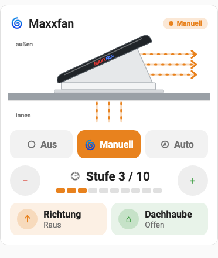

# Maxxfan Card

Lovelace-Karte für Home Assistant zur Steuerung eines Maxxfan-Dachlüfters,
der per MQTT angebunden ist. Die Karte kommt ohne Template-Switches und ohne
Skripte aus: Sie liest die MQTT-Entitäten und sendet Kommandos direkt per
`mqtt.publish` bzw. an die MQTT-Entitäten für Drehzahl und Zieltemperatur.

Oben zeigt eine vereinfachte Seitenansicht den Lüfter auf dem Dach: Die
dunkle Haube hebt sich animiert samt weißer Seitenschürze, und animierte
Linien zeigen den Luftstrom durch die Öffnung – orange nach draußen, blau nach
drinnen (im Modus Manuell umso schneller, je höher die Stufe).



## Modi und Bedienung

| Modus | Moduswechsel | Drehzahl ± | Richtung | Dachhaube | Zieltemperatur ± |
|---|---|---|---|---|---|
| **Aus** | Manuell, Auto | – | – | ✔ | – |
| **Manuell** | Aus, Auto | ✔ | ✔ | ✔ | – |
| **Auto** | Aus, Manuell | – | – | nur Anzeige | ✔ |

Alle MQTT-Kommandos des Maxxfan sind Toggles (leeres Payload). Nach einem
Tipp ist die Taste gesperrt (sie pulsiert), bis sich der Status ändert –
höchstens 5 Sekunden. So schaltet ein Doppeltipp nicht versehentlich zurück.

Moduswechsel:

| Von → Nach | gesendet |
|---|---|
| Aus → Manuell | `power` |
| Aus → Auto | `auto` |
| Manuell → Aus | `power` |
| Manuell → Auto | `auto` |
| Auto → Aus | `power` |
| Auto → Manuell | `power`, 1 s Pause, `power` |

## Installation über HACS

1. HACS öffnen → Menü (⋮) → **Benutzerdefinierte Repositories**.
2. `https://github.com/abcklaus/maxxfan-card` eintragen, Typ **Dashboard** wählen.
3. „Maxxfan Card“ suchen und herunterladen.
4. Browser neu laden (Cache leeren).

### Manuell

`dist/maxxfan-card.js` nach `/config/www/` kopieren und unter
*Einstellungen → Dashboards → Ressourcen* als JavaScript-Modul
`/local/maxxfan-card.js` hinzufügen.

## Konfiguration

Die Karte lässt sich im grafischen Editor einrichten. Alle Optionen haben
Standardwerte, die zur MQTT-Konfiguration unten passen – im einfachsten Fall
reicht:

```yaml
type: custom:maxxfan-card
```

### Alle Optionen

| Option | Standard | Beschreibung |
|---|---|---|
| `name` | `Maxxfan` | Titel |
| `mode_entity` | `sensor.maxxfan_modus` | Modus (`Aus` / `Manuell` / `Auto`) |
| `fan_entity` | `fan.maxxfan` | MQTT-Fan für Drehzahl (`fan.set_percentage`) |
| `temperature_entity` | `number.maxxfan_zieltemperatur` | Zieltemperatur (`number.set_value`) |
| `direction_entity` | `sensor.maxxfan_richtung_status` | Richtung (`in`/`out`, oder binary_sensor: an = raus) |
| `vent_entity` | `sensor.maxxfan_dachluke_status` | Dachhaube (`open`/`close`, oder binary_sensor: an = offen) |
| `auto_entity` | `sensor.maxxfan_auto_status` | Auto-Status; nur genutzt, wenn der Modus-Sensor fehlt |
| `topics.power` | `pkw/cmnd/maxxfan/power` | Toggle Ein/Aus |
| `topics.auto` | `pkw/cmnd/maxxfan/auto` | Toggle Auto |
| `topics.direction` | `pkw/cmnd/maxxfan/direction` | Toggle Richtung |
| `topics.vent` | `pkw/cmnd/maxxfan/vent` | Toggle Dachhaube |
| `show_diagram` | `true` | Grafik anzeigen |

Die Farben lassen sich mit card-mod über die CSS-Variablen
`--maxxfan-active`, `--maxxfan-off`, `--maxxfan-out`, `--maxxfan-in` und
`--maxxfan-open` anpassen.

## Benötigte MQTT-Entitäten

Auszug aus der `configuration.yaml` (Status kommt als JSON auf
`pkw/tele/maxxfan`):

```yaml
mqtt:
  fan:
    - name: "MaxxFan"
      unique_id: maxxfan_fan
      command_topic: "pkw/cmnd/maxxfan/power"
      command_template: "{{ '' }}"
      state_topic: "pkw/tele/maxxfan"
      state_value_template: "{{ 'ON' if value_json.maxxfan.fan_power else 'OFF' }}"
      percentage_state_topic: "pkw/tele/maxxfan"
      percentage_value_template: "{{ value_json.maxxfan.fan_speed }}"
      percentage_command_topic: "pkw/cmnd/maxxfan/speed"
      speed_range_min: 1
      speed_range_max: 10
  number:
    - name: "MaxxFan Zieltemperatur"
      unique_id: maxxfan_temp
      state_topic: "pkw/tele/maxxfan"
      value_template: "{{ value_json.maxxfan.fan_temp }}"
      command_topic: "pkw/cmnd/maxxfan/temp"
      min: 15
      max: 37
  sensor:
    - name: "Maxxfan Modus"
      unique_id: maxxfan_mode
      state_topic: "maxxfan/stat/mode"
    - name: "Maxxfan Richtung Status"
      unique_id: maxxfan_direction_status
      state_topic: "pkw/tele/maxxfan"
      value_template: "{{ value_json.maxxfan.fan_direction }}"
    - name: "Maxxfan Dachluke Status"
      unique_id: maxxfan_vent_status
      state_topic: "pkw/tele/maxxfan"
      value_template: "{{ value_json.maxxfan.fan_vent }}"
```

## Entwicklung

```bash
npm run build   # erzeugt dist/maxxfan-card.js
```

`demo/index.html` im Browser öffnen, um die Karte mit einem simulierten
Lüfter auszuprobieren (Startzustand per URL, z. B. `?mode=Auto&dir=in&dark=1`).

Für ein Release einen GitHub-Release mit Tag `vX.Y.Z` anlegen – der Workflow
baut die Datei und hängt sie an.
